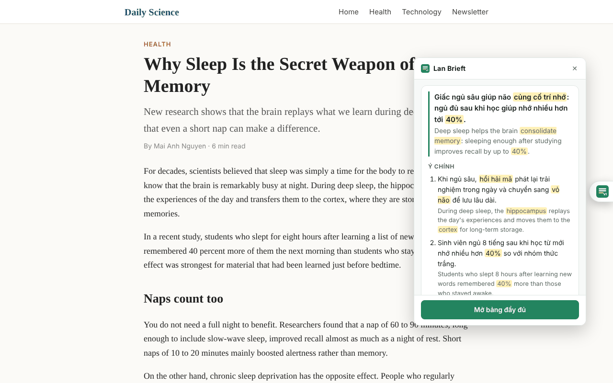
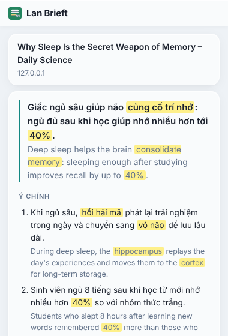
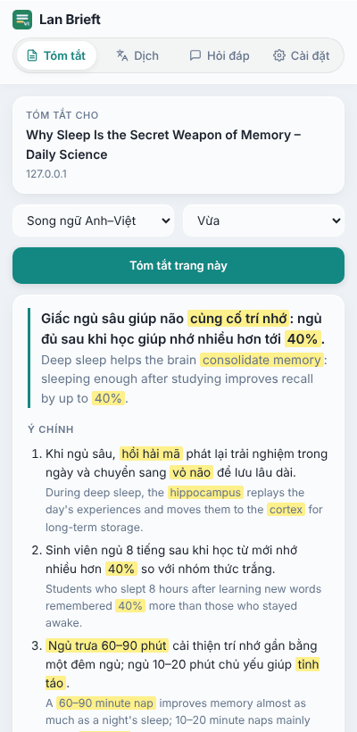
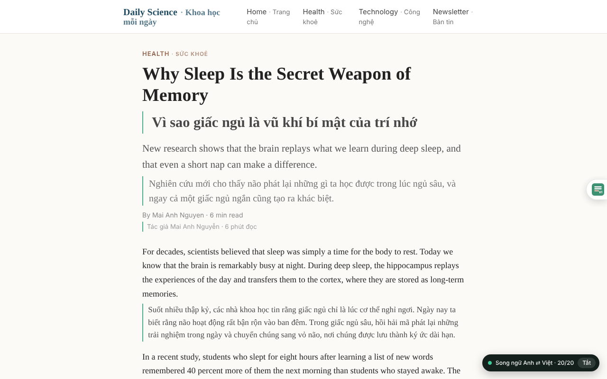
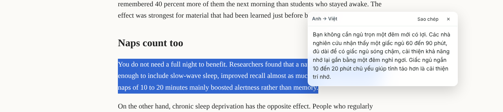
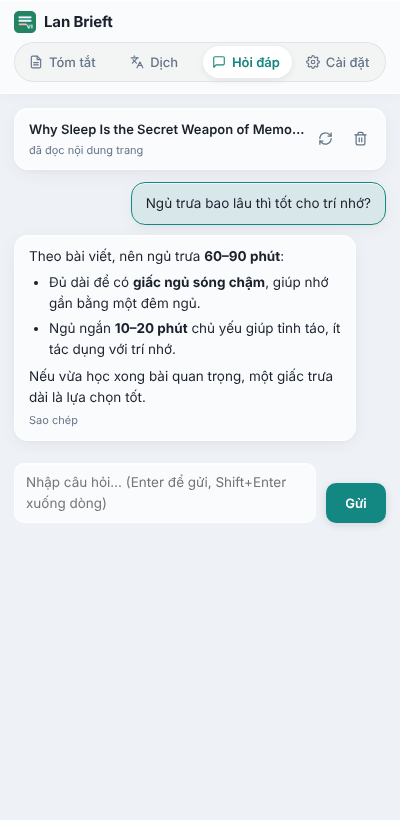
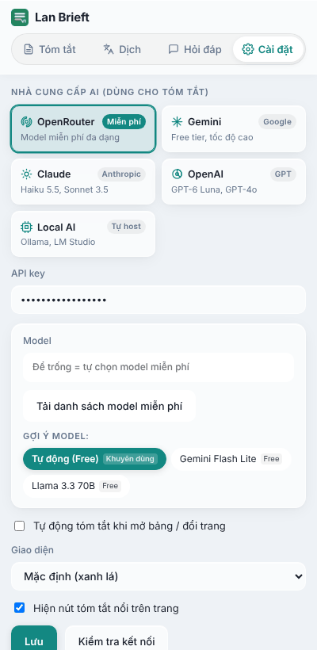
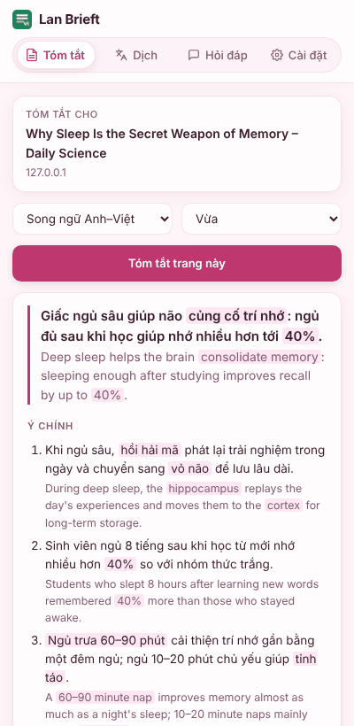

# Lan Brieft – Tóm tắt & Dịch song ngữ Anh ⇄ Việt

**Tiếng Việt** · [English](README.en.md)

Extension Chrome (Manifest V3) lấy cảm hứng từ *TLDR Summarizer AI*, gồm 3 chức năng:

1. **Tóm tắt trang đang xem**: 1 câu TL;DR + 3/5/8 ý chính (từ khoá được tô sáng) + đoạn tóm tắt. Mặc định tóm tắt **song ngữ Anh–Việt** (mỗi câu tiếng Việt kèm bản tiếng Anh ngay bên dưới); có thể chọn chỉ Tiếng Việt / English / theo ngôn ngữ trang và độ dài. Xem nhanh trong popup khi bấm icon, hoặc trong Side Panel đầy đủ.
2. **Dịch song ngữ Anh ⇄ Việt ngay trên trang**: bản dịch chèn ngay dưới từng đoạn (kiểu Immersive Translate), tự nhận diện chiều dịch theo từng đoạn, chỉ dịch phần sắp cuộn tới để tiết kiệm. Kèm dịch đoạn đã bôi đen (chuột phải) và ô dịch nhanh trong panel.
3. **Hỏi đáp về trang**: chat với AI về nội dung trang sau khi tóm tắt — hỏi thêm chi tiết, hoặc nháp **email phản hồi** khi trang là một email (tab **Hỏi đáp** trong Side Panel).

## Hình ảnh

### Tóm tắt ngay trên trang

Bấm **nút nổi** ở cạnh phải màn hình: thẻ tóm tắt song ngữ hiện ngay cạnh nút, mỗi câu tiếng Việt kèm bản tiếng Anh, từ khoá được tô sáng.

### Popup tóm tắt nhanh và Side Panel

Bấm icon trên thanh công cụ (hoặc `Alt+S`) để xem tóm tắt trong popup; **Mở bảng đầy đủ** mở Side Panel với 4 tab Tóm tắt · Dịch · Hỏi đáp · Cài đặt.

  
  &nbsp;
  

### Dịch song ngữ ngay trên trang

Bản dịch tiếng Việt chèn ngay dưới từng đoạn; chữ ngắn trong menu được dịch cùng dòng để không vỡ bố cục. Badge góc phải dưới cho biết tiến độ và có nút **Tắt**.

### Tóm tắt hoặc dịch đoạn bôi đen

Bôi đen đoạn dài hơn 100 ký tự: hai nút **Tóm tắt đoạn này** và **Dịch đoạn này** hiện ngay dưới vùng chọn. Bấm dịch thì popup bản dịch hiện phía trên chỗ chuột vừa thả, có nút **Sao chép**.

### Hỏi đáp về trang

Tab **Hỏi đáp**: hỏi thêm về nội dung trang hoặc nháp email phản hồi. AI đọc chính nội dung trang nên trả lời được cả chi tiết không có trong bản tóm tắt.

### Cài đặt và giao diện

Chọn nhà cung cấp AI, nhập API key, chọn model. Có hai giao diện: *Mặc định (xanh lá)* và *Trắng hồng dịu*.

  
  &nbsp;
  

## Cài đặt (chế độ developer)

1. Vào mục [**Releases**](https://github.com/kobevn9x/ViBrief/releases), tải file `vibrief-x.y.z.zip` của bản mới nhất rồi giải nén (hoặc bấm **Code → Download ZIP** ở trang chính).
2. Mở `chrome://extensions` → bật **Developer mode** (góc phải trên).
3. Bấm **Load unpacked** → chọn thư mục vừa giải nén.
4. Ghim icon Lan Brieft lên thanh công cụ.
5. Lấy API key **miễn phí** tại <https://openrouter.ai/keys> (cần tạo tài khoản OpenRouter).
6. Mở Side Panel (bấm icon hoặc `Alt+S` → **Mở bảng đầy đủ**) → tab **Cài đặt** → nhà cung cấp mặc định là **OpenRouter (model miễn phí)**, dán API key → **Lưu** → **Kiểm tra kết nối**.

Dịch bằng Google không cần key – dùng được ngay sau khi cài.

**Cập nhật lên bản mới:** tải file zip mới ở Releases, giải nén đè lên thư mục cũ, rồi bấm nút tải lại (⟳) trên thẻ Lan Brieft trong `chrome://extensions`. Cài đặt và API key đã lưu vẫn giữ nguyên.

## Cách dùng

| Việc | Thao tác |
|---|---|
| Tóm tắt ngay trên trang | Bấm **nút nổi** ở giữa cạnh phải màn hình → thẻ tóm tắt song ngữ hiện ngay cạnh nút (✕ hoặc `Esc` để đóng) |
| Tóm tắt nhanh | Bấm icon trên thanh công cụ hoặc `Alt+S` → popup hiện tóm tắt ngay cho trang đang xem |
| Mở bảng đầy đủ | Trong popup bấm **Mở bảng đầy đủ** → mở Side Panel (Tóm tắt · Dịch · Hỏi đáp · Cài đặt) |
| Tóm tắt trong Side Panel | Chuột phải → *Tóm tắt trang này*, hoặc **Tóm tắt trang này** trong panel |
| Tóm tắt đoạn bôi đen | Kéo chuột bôi đen đoạn > 100 ký tự → bấm nút **Tóm tắt đoạn này** hiện ngay cạnh vùng chọn (hoặc chuột phải → *Tóm tắt đoạn đã chọn*) |
| Dịch đoạn bôi đen | Cùng chỗ đó có nút **Dịch đoạn này** (popup dịch Anh ⇄ Việt, có nút Sao chép); đoạn ngắn hơn thì chuột phải → *Dịch đoạn đã chọn* |
| Hỏi thêm về trang | Tab **Hỏi đáp** → nhập câu hỏi (`Enter` để gửi); hoặc bấm **Hỏi thêm** dưới bản tóm tắt. Thẻ ✉️ **Viết phản hồi** luôn có (email, ticket Freshdesk/Zendesk, tin nhắn…) |
| Bật/tắt song ngữ | Tab **Dịch** → công tắc, hoặc `Alt+T`, hoặc chuột phải → *Dịch song ngữ trang này*; tắt bằng nút **Tắt** ở badge góc phải dưới |
| Dịch đoạn chọn | Bôi đen → chuột phải → *Dịch đoạn đã chọn* (popup nổi, có nút Sao chép) |
| Dịch nhanh | Tab **Dịch** → dán văn bản → **Dịch** (`Ctrl+Enter`) |

Phím tắt đang dùng hiện ở cuối popup và trong tab **Cài đặt** → **Phím tắt** (ghi *Chưa gán* nếu Chrome không gán được, thường do trùng với extension khác). Bấm **Đổi phím tắt** (hoặc mở `chrome://extensions/shortcuts`) để đặt lại.

### Dịch song ngữ trên trang

- Bản dịch hiện ngay dưới từng đoạn. Chữ ngắn trong menu, thanh điều hướng, tab, ô bảng… được dịch **cùng dòng** (vd. *Home · Trang chủ*) để không làm vỡ bố cục trang.
- Dịch cả nội dung trong web component (Shadow DOM), nội dung ẩn khi mới bật (tab, mục thu gọn — dịch khi bạn mở ra) và nội dung trang tự cập nhật. Không dịch nội dung trong iframe, ô nhập liệu, khối code.
- Đoạn dịch lỗi (vd. Google tạm giới hạn lượt gọi) được tự thử lại; số đoạn lỗi hiện trên badge góc phải dưới.
- Sau khi cập nhật/tải lại extension, chỉ cần bật lại song ngữ (không cần tải lại trang).

### Tóm tắt đoạn bôi đen

- Bôi đen một đoạn **dài hơn 100 ký tự** → hai nút nhỏ **Tóm tắt đoạn này** và **Dịch đoạn này** hiện ngay dưới vùng chọn; bấm tóm tắt thì thẻ kết quả hiện cạnh đoạn đó và **chỉ đoạn đó** được gửi cho AI, bấm dịch thì popup bản dịch hiện ngay dưới đoạn.
- Khi đang bôi đen đoạn đủ dài, nút nổi, popup (icon hoặc `Alt+S`), nút **Tóm tắt trang này** trong Side Panel và chuột phải → *Tóm tắt đoạn đã chọn* cũng chỉ tóm tắt đoạn đó. Đoạn ngắn hơn 100 ký tự thì không hiện nút và vẫn tóm tắt cả trang.
- Đoạn ngắn được tóm tắt gọn hơn (ít ý hơn). Kết quả của đoạn chọn không lưu bộ nhớ đệm, nên không ảnh hưởng bản tóm tắt cả trang đã có.
- Không hiện nút khi bôi đen trong ô nhập liệu. Nút ẩn đi khi bỏ chọn, cuộn trang hoặc nhấn `Esc`; tắt cùng tuỳ chọn **Hiện nút tóm tắt nổi trên trang**.

Ngôn ngữ tóm tắt: **Song ngữ Anh–Việt** (mặc định) · Tiếng Việt · English · Theo ngôn ngữ trang. Nút **Sao chép** chép cả phần tiếng Việt và phần tiếng Anh.

### Hỏi đáp về trang

- Tab **Hỏi đáp** trong Side Panel: hỏi thêm bất cứ điều gì về trang đang xem — AI đọc trực tiếp nội dung trang (tối đa 20.000 ký tự đầu) cùng bản tóm tắt bạn vừa đọc, nên trả lời được cả chi tiết không có trong bản tóm tắt. Nút **Hỏi thêm** dưới kết quả tóm tắt nhảy thẳng sang tab này.
- Bấm một **thẻ gợi ý** trong tab Hỏi đáp là **gửi ngay** câu đó (không cần bấm Gửi); nội dung bạn đang gõ dở trong ô nhập được giữ nguyên. Riêng thẻ **✉️ Viết phản hồi** chỉ điền sẵn câu vào ô nhập (con trỏ ở cuối) để bạn thêm **phong cách trả lời** rồi tự bấm Gửi.
- Thẻ **✉️ Viết phản hồi** **luôn hiện** trong tab Hỏi đáp, không phụ thuộc loại trang: Gmail, Outlook, ticket Freshdesk / Zendesk / Help Scout…, hay bất kỳ trang có tin nhắn cần trả lời. Trang giống thư/helpdesk (nhận biết qua tên miền, đường dẫn và tiêu đề tab, không đọc nội dung trang) thì thẻ xếp đầu hàng, còn lại xếp cuối.
- Chọn **phong cách** nhanh bằng các nút dưới thẻ: *Lịch sự · Ngắn gọn · Xin lỗi & giải thích · Từ chối khéo · Hỗ trợ khách hàng* (bấm nhiều nút để kết hợp), hoặc gõ tự do. Phong cách bạn dùng lần trước được điền sẵn cho lần sau.
- **Bôi đen tin cần trả lời** (cả khi tin nằm trong iframe, như nội dung ticket) rồi bấm Gửi: AI trả lời đúng đoạn đó; thanh ngữ cảnh ghi "kèm đoạn bôi đen". Đoạn bôi đen (từ 20 ký tự) được giữ cho cả hội thoại cho tới khi bạn bôi đoạn khác hoặc bấm 🗑. Không bôi đen thì AI trả lời email đang mở trên màn hình; với chuỗi thư/ticket thì trả lời tin **mới nhất của người gửi/khách** (bỏ qua ghi chú nội bộ và các lần trả lời trước của bạn). Bản nháp viết **theo ngôn ngữ của tin cần trả lời** (trừ khi bạn yêu cầu khác), có dòng Tiêu đề, dùng `[chỗ trống]` cho ngày, giá, cam kết hay tên người gửi không có trong tin — AI không tự bịa thông tin. Nếu trang không có tin nào để trả lời, AI nói rõ và nhờ bạn bôi đen tin cần trả lời.
- Nếu không đọc được nội dung trang, tab báo lỗi và **không gửi** câu hỏi (không để AI trả lời như thể chưa thấy trang); bấm ⟳ để đọc lại.
- Trả lời hiện dần từng chữ; `Shift+Enter` xuống dòng; nút **Dừng** cắt giữa lúc trả lời nhưng giữ lại phần đã viết; mỗi câu trả lời có nút **Sao chép**.
- Hội thoại nhiều lượt giữ nguyên ngữ cảnh, lưu tạm **theo từng trang** trong bộ nhớ phiên (mất khi đóng trình duyệt) — đóng và mở lại Side Panel trên cùng trang vẫn tiếp tục được. Nút ⟳ đọc lại nội dung trang, nút 🗑 xoá hội thoại ngay.
- AI trả lời theo ngôn ngữ của câu hỏi bạn gõ.

### Nút tóm tắt nổi

- Hiện trên mọi trang web (trừ trang hệ thống của Chrome, Chrome Web Store và PDF). Nút chỉ dựng giao diện, **không đọc nội dung trang cho tới khi bạn bấm** (riêng đoạn bạn bôi đen thì chỉ được đo độ dài ngay trên máy để quyết định hiện nút **Tóm tắt đoạn này** / **Dịch đoạn này**, không gửi đi đâu).
- Kết quả dùng chung bộ nhớ đệm với popup và Side Panel. Nút **Mở bảng đầy đủ** trong thẻ mở Side Panel (nếu Chrome không cho, nhấn `Alt+S` rồi bấm **Mở bảng đầy đủ** trong popup).
- Tắt nút: tab **Cài đặt** → bỏ chọn **Hiện nút tóm tắt nổi trên trang** (áp dụng ngay, không cần tải lại trang).
- Sau khi cập nhật/tải lại extension, cần tải lại các trang đang mở để nút hoạt động lại.

### Giao diện

Tab **Cài đặt** → **Giao diện**: *Mặc định (xanh lá)* hoặc *Trắng hồng dịu*. Áp dụng cho popup, Side Panel, nút nổi, thẻ tóm tắt, popup dịch đoạn chọn và badge song ngữ trên trang. Theme hồng luôn ở tông sáng (kể cả khi máy đang ở chế độ tối) và đạt độ tương phản WCAG AA.

## Nhà cung cấp AI hỗ trợ

| Provider | Model mặc định | Ghi chú |
|---|---|---|
| **OpenRouter** (mặc định) | *(để trống)* – tự chọn model miễn phí | Xem mục bên dưới |
| OpenAI | `gpt-6-luna` | Model rẻ nhất hiện tại của OpenAI |
| Anthropic | `claude-haiku-5-5` | Gọi trực tiếp từ trình duyệt (header `anthropic-dangerous-direct-browser-access`) |
| Google Gemini | `gemini-3.6-flash` | Có free tier trên AI Studio |
| OpenAI-compatible | `llama3.1` @ `http://localhost:11434/v1` | Ollama / LM Studio… Với Ollama cần đặt biến môi trường `OLLAMA_ORIGINS=chrome-extension://*` |

Tên model sửa tự do trong Cài đặt. Bộ máy dịch có thể chuyển sang **AI** (chất lượng tốt hơn với văn bản chuyên ngành, tốn token).

### OpenRouter – model miễn phí

- Để trống ô **Model** → extension tự lấy danh sách model miễn phí (các model có đuôi `:free`) từ OpenRouter và dùng model đầu tiên.
- Muốn chọn model cụ thể: bấm **Tải danh sách model miễn phí** trong tab Cài đặt → chọn một model trong ô Model hoặc bấm một thẻ gợi ý model → **Lưu**.
- Model miễn phí **vẫn cần API key** (miễn phí) tạo tại <https://openrouter.ai/keys>.
- Model miễn phí bị giới hạn số lượt gọi (theo phút và theo ngày, do OpenRouter quy định). Nếu gặp lỗi giới hạn, đợi một lúc, đổi sang model miễn phí khác, hoặc dùng provider khác.

## Quyền riêng tư

Extension **không có máy chủ riêng**, không có analytics, không thu thập dữ liệu. Cài đặt và API key chỉ lưu trên máy bạn (`chrome.storage.local`, không đồng bộ qua tài khoản Google). Dữ liệu chỉ rời máy khi bạn chủ động dùng một chức năng:

| Khi bạn… | Dữ liệu được gửi | Gửi tới |
|---|---|---|
| Tóm tắt (popup / `Alt+S`, Side Panel, nút nổi, menu chuột phải) | Tiêu đề, URL và chữ của bài (hoặc đoạn đang bôi đen), tối đa 12.000 / 20.000 / 32.000 ký tự tuỳ độ dài | Nhà cung cấp AI bạn chọn. Mặc định là OpenRouter, nơi chuyển tiếp tới nhà cung cấp của model |
| Tóm tắt ở chế độ **Song ngữ** (mặc định) | Thêm: bản tóm tắt tiếng Việt (không phải cả trang) để dịch sang tiếng Anh | `translate.googleapis.com` (Google Translate). Nếu Google lỗi thì gửi cho nhà cung cấp AI |
| Tóm tắt mà AI trả lời sai ngôn ngữ (vd. trang tiếng Trung → tóm tắt tiếng Trung) | Thêm: bản tóm tắt đó để dịch sang ngôn ngữ đã chọn | Chế độ **Song ngữ**: Google Translate, lỗi thì nhà cung cấp AI. Chế độ *Tiếng Việt* / *English*: chỉ nhà cung cấp AI |
| Bật dịch song ngữ trang, dịch đoạn chọn, dịch nhanh | Chữ của các đoạn cần dịch | Bộ máy dịch đang chọn: Google (mặc định) hoặc nhà cung cấp AI |
| Hỏi đáp về trang (tab **Hỏi đáp**) | Câu hỏi của bạn + tiêu đề, URL, chữ của trang (tối đa 20.000 ký tự) + đoạn bạn đang bôi đen (nếu có, tối đa 8.000 ký tự) + bản tóm tắt đang xem (nếu có) + các lượt hội thoại trước | Nhà cung cấp AI bạn chọn |
| Kiểm tra kết nối | Một câu kiểm tra ngắn | Nhà cung cấp AI |
| Tải danh sách model miễn phí / để trống ô Model | Không gửi dữ liệu của bạn (chỉ đọc danh sách model công khai) | `openrouter.ai` |

- **Chỉ mở trang thì không gửi gì.** Nút nổi chỉ dựng giao diện. Nội dung trang chỉ được đọc khi chính bạn bấm, và script của trang web không thể "bấm hộ" (extension bỏ qua mọi cú bấm giả).
- **Kết quả tóm tắt** và **hội thoại Hỏi đáp** (kèm chữ của trang đã đọc cho tab đó) chỉ lưu tạm trong bộ nhớ phiên (`chrome.storage.session`) và mất khi đóng trình duyệt; xoá hội thoại bằng nút 🗑 trong tab Hỏi đáp.
- **Model miễn phí:** dữ liệu gửi đi tuân theo chính sách của từng nhà cung cấp. Một số model miễn phí trên OpenRouter có thể được nhà cung cấp lưu lại hoặc dùng để huấn luyện; hãy xem phần cài đặt quyền riêng tư trong tài khoản OpenRouter.
- **Nội dung nhạy cảm** (email, tài liệu nội bộ), nên chọn một trong các cách sau:
  - dùng key trả phí của nhà cung cấp có cam kết không lưu dữ liệu;
  - chạy model trên máy bằng **Ollama** (provider *OpenAI-compatible*), dữ liệu không rời máy;
  - chọn ngôn ngữ tóm tắt *Tiếng Việt* hoặc *English* thay vì *Song ngữ*, để bản tóm tắt không gửi sang Google Translate;
  - đổi *Bộ máy dịch* sang AI.
- **Quyền extension yêu cầu:**
  - `<all_urls>` + content script: hiện nút nổi trên mọi trang, đọc nội dung khi bạn yêu cầu, và gọi API của nhà cung cấp AI / Google Translate;
  - `scripting`, `activeTab`, `tabs`: đọc nội dung tab đang xem khi tóm tắt hoặc dịch;
  - `storage`: lưu cài đặt;
  - `sidePanel`, `contextMenus`: giao diện.

## Giới hạn hiện tại

- Không chạy trên `chrome://`, Chrome Web Store và trình xem PDF tích hợp (Chrome chặn script). Chưa có tải PDF lên như bản gốc.
- Endpoint Google Translate dùng là endpoint web công khai (`translate.googleapis.com … client=gtx`), không có SLA; dịch nhiều có thể bị giới hạn tạm thời → chuyển sang bộ máy AI.
- Model miễn phí của OpenRouter có giới hạn lượt gọi và danh sách model miễn phí có thể thay đổi theo thời gian.
- Trang SPA vẽ lại DOM liên tục: bản dịch được tự chèn lại tối đa 3 lần mỗi đoạn; sau đó tắt/bật lại song ngữ để dịch lại.
- Tóm tắt đoạn bôi đen chỉ đọc vùng chọn ở trang chính (không đọc vùng chọn trong iframe hay trong ô nhập liệu).

## Thay đổi

### v1.3.4
- **Giao diện mới** cho popup, Side Panel và nút nổi: thẻ dạng kính mờ, thanh tab có vệt trượt theo tab đang chọn, thêm icon cho tab và nút.
- Tab **Cài đặt**: chọn nhà cung cấp AI bằng các thẻ (OpenRouter, Gemini, Claude, OpenAI, Local AI) và chọn model nhanh bằng **thẻ gợi ý model** (gồm cả các model miễn phí vừa tải về).
- Popup dịch đoạn chọn và badge dịch song ngữ đổi theo giao diện đang dùng (kể cả *Trắng hồng dịu*); hai nút cạnh đoạn bôi đen và popup dịch có hiệu ứng hiện ra nhẹ.
- **Viết phản hồi**: khi tin cần trả lời viết bằng ngoại ngữ, bản nháp luôn viết đúng ngôn ngữ đó (kể cả khi bạn hỏi bằng tiếng Việt), trừ khi bạn ghi rõ "bằng tiếng Việt".

### v1.3.3
- Bôi đen đoạn dài giờ hiện thêm nút **Dịch đoạn này** cạnh nút **Tóm tắt đoạn này**; bấm vào để xem bản dịch Anh ⇄ Việt trong popup (có nút Sao chép).
- Popup dịch đoạn chọn hiện **ngay phía trên chỗ chuột vừa thả** (lật xuống dưới hoặc co lại khi thiếu chỗ), không còn bị đẩy ra ngoài màn hình với đoạn dài.

### v1.3.2
- Thẻ **✉️ Viết phản hồi** **luôn hiện** trong tab Hỏi đáp (trước đây chỉ trên webmail nên ticket Freshdesk/Zendesk… không có). Trang giống thư/helpdesk chỉ quyết định thẻ xếp đầu hay cuối hàng.
- Thêm các nút **chọn nhanh phong cách** trả lời (Lịch sự, Ngắn gọn, Xin lỗi & giải thích, Từ chối khéo, Hỗ trợ khách hàng) và **nhớ phong cách** dùng lần trước.
- **Bôi đen tin cần trả lời** (đọc cả iframe, như nội dung ticket): AI trả lời đúng đoạn đó, giữ cho cả hội thoại, xoá bằng 🗑; trang đọc lỗi mà có đoạn bôi đen thì vẫn gửi được.
- Với chuỗi thư/ticket, AI trả lời tin **mới nhất của người gửi/khách**, bỏ qua ghi chú nội bộ; không có tin nào để trả lời thì nhờ bạn bôi đen.
- Đoạn bôi đen được gửi cho nhà cung cấp AI khi hỏi đáp (tối đa 8.000 ký tự) — đã ghi vào bảng quyền riêng tư.

### v1.3.1
- Tab **Hỏi đáp**: bấm thẻ gợi ý là **gửi ngay**, không cần bấm Gửi; chữ đang gõ dở trong ô nhập được giữ nguyên. Thẻ **✉️ Viết email phản hồi** là ngoại lệ: chỉ điền sẵn câu vào ô nhập để bạn thêm phong cách trả lời (lịch sự, ngắn gọn, từ chối khéo…) rồi tự bấm Gửi; AI làm theo phong cách bạn yêu cầu.
- Không còn gửi trùng khi bấm đúp thẻ hoặc gửi liên tiếp lúc đang đọc trang; nút **Dừng** dùng được ngay cả khi đang đọc trang.
- Đọc trang thất bại (hoặc gần như không có chữ) thì báo lỗi và không gửi câu hỏi, thay vì để AI trả lời như thể chưa thấy trang.
- **Viết email phản hồi**: trả lời email đang mở trên màn hình (chuỗi thư thì trả lời thư mới nhất), viết theo ngôn ngữ của email, có dòng Tiêu đề, dùng `[chỗ trống]` cho thông tin không có trong email và không bịa. Nội dung trang được coi là dữ liệu không đáng tin, không thể ra lệnh cho AI.
### v1.3.0
- **Tab Hỏi đáp mới** trong Side Panel: trò chuyện với AI về trang đang xem sau khi tóm tắt — AI đọc trực tiếp nội dung trang (tối đa 20.000 ký tự) cùng bản tóm tắt đang mở, nên trả lời được cả chi tiết không nằm trong bản tóm tắt. Nút **Hỏi thêm** dưới kết quả tóm tắt nhảy thẳng sang tab này.
- Trả lời hiện dần từng chữ, `Shift+Enter` xuống dòng, nút **Dừng** giữa lúc stream (giữ phần đã viết) và **Sao chép** từng câu trả lời.
- Trên webmail (Gmail, Outlook…), tab gợi ý kèm thẻ **✉️ Viết email phản hồi** — AI nháp thư phản hồi cho email đang mở, theo ngôn ngữ của email.
- Bấm thẻ gợi ý là gửi ngay (trừ thẻ ✉️ Viết email phản hồi: điền sẵn câu để bạn thêm phong cách trả lời rồi tự gửi); bấm đúp hay gửi liên tiếp khi đang đọc trang không còn gửi trùng; đọc trang lỗi thì báo lỗi thay vì để AI trả lời mà không có nội dung trang.
- Hội thoại lưu tạm theo từng trang trong bộ nhớ phiên (mất khi đóng trình duyệt); nút ⟳ đọc lại nội dung trang, nút 🗑 xoá hội thoại.

### v1.2.1
- Đổi tên hiển thị thành **Lan Brieft** (trước đây là ViBrief). Repo, link tải và tên file zip giữ nguyên; cài đặt và API key đã lưu không bị ảnh hưởng.
- **Tóm tắt đoạn bôi đen**: bôi đen đoạn > 100 ký tự → nút **Tóm tắt đoạn này** hiện cạnh vùng chọn, thẻ kết quả hiện ngay tại đó và chỉ đoạn đó được gửi cho AI.
- Nút nổi, popup / `Alt+S`, Side Panel và menu chuột phải mới *Tóm tắt đoạn đã chọn* đều tự nhận đoạn đang bôi đen (trước đây cần > 300 ký tự và hay trả lại bản tóm tắt cả trang đã lưu).
- Đoạn ngắn được tóm tắt gọn hơn; tóm tắt đoạn chọn không ghi đè bộ nhớ đệm của cả trang.

### v1.2.0
- `Alt+S` mở popup tóm tắt nhanh (trước đây bấm không thấy gì vì Chrome chặn mở Side Panel). Phím tắt đang dùng hiện ở cuối popup và tab **Cài đặt → Phím tắt**, báo *Chưa gán* nếu bị trùng, có nút **Đổi phím tắt**.
- Dịch song ngữ ổn định hơn: dịch được link dạng khối, thẻ tự định nghĩa, chữ nằm cạnh danh sách con, nội dung trong Shadow DOM, nội dung ẩn lúc bật (tab, mục thu gọn) và nội dung trang tự cập nhật; tự thử lại khi Google giới hạn lượt gọi.
- Chữ ngắn trong menu, thanh điều hướng, tab, ô bảng được dịch cùng dòng (vd. *Home · Trang chủ*) để không vỡ bố cục.

---

Phát triển bởi [Kobe](https://github.com/kobevn9x).
